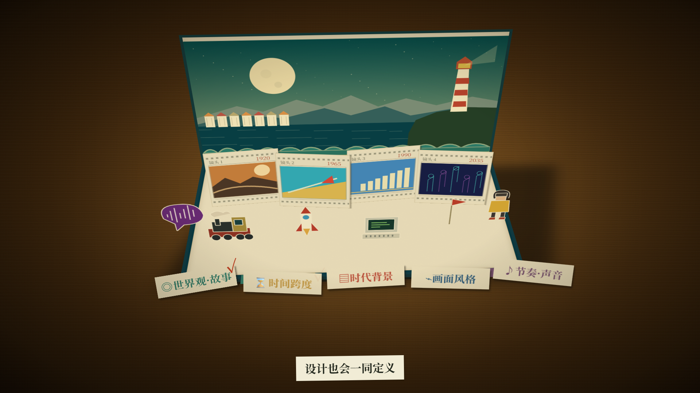

# 立体书：约束越多，作品越能脱颖而出

用 **Remotion + React + SVG + CSS 3D** 重建纸艺立体书动画。画面由组件生成，不是把参考 MP4 包装成播放器。包含完整源代码、依赖锁文件、本地纸纹、中文字体依赖和原片音轨。

- 1920 × 1080，30 fps，1146 帧，38.2 秒。
- 参考片段：[Motionface](https://motionface.cc/?recording=ad1b3f0a-1770-4743-a28f-9a7ad9c378af)。
- 动画：OMNI 提示词盒子 → Gemini 对话 → 合上手册 → 灯塔海岸立体书 → 四联分镜与纸片道具 → 拉远对比 → 散落纸张 → 重新展开。
- 所有位移、折叠和字幕均由 `useCurrentFrame()` 驱动，无 CSS 动画、计时器或不确定随机数。



## 运行

需要 Node.js 20.19+、22.13+ 或 24+（本次使用 Node 24）。

```bash
npm ci
npm run dev
```

在终端显示的本地地址打开 Studio，选择 `PopupBook`。

## 渲染

```bash
# 1080p H.264 MP4，含配音
npm run render

# 540p 快速预览
npm run render:preview

# 24.5 秒海报帧
npm run still

# 检查及打包
npm run lint
npm run build
```

成片输出到 `out/popup-book.mp4`。首次渲染时 Remotion 可能下载 Chrome Headless Shell。若已有 Chrome，可显式指定，例如 Windows：

```powershell
npm run render -- --browser-executable="C:\Program Files\Google\Chrome\Application\chrome.exe" --concurrency=6
```

## 编辑位置

| 文件 | 内容 |
| --- | --- |
| `src/PopupBook.tsx` | 统一时间轴、镜头、书本开合、纸片、对话与散纸 |
| `src/art.tsx` | SVG 海岸、灯塔、分镜、火车、火箭、电脑和人物 |
| `src/timeline.ts` | 中文字幕与时间范围 |
| `src/style.css` | 纸张材质、暖色桌面、透视、字体与阴影 |
| `src/Root.tsx` | 尺寸、帧率、总帧数 |
| `public/narration.m4a` | 从用户提供参考视频提取的音轨 |
| `public/paper.svg` | 本地可复现纸纹 |

## 复刻范围

重建参考片的构图语言、色系、叙事顺序和主要折叠动作。插画为重新绘制的简化矢量纸艺，阴影使用 CSS 近似；与原片三维模型、物理光照、纹理和细微运动仍有差异，不宣称逐像素一致。中文字幕按可见字幕核对，音轨保留原时间轴。

参考视频只用于本地分析，未提交原始 MP4、临时下载地址或任何绑定凭证。音轨来源是上方参考片段；Noto Serif SC 由 Fontsource 提供，遵循其随包提供的 OFL 许可。

分析与验证记录见 [docs/analysis.md](docs/analysis.md) 和 [docs/verification.md](docs/verification.md)。

